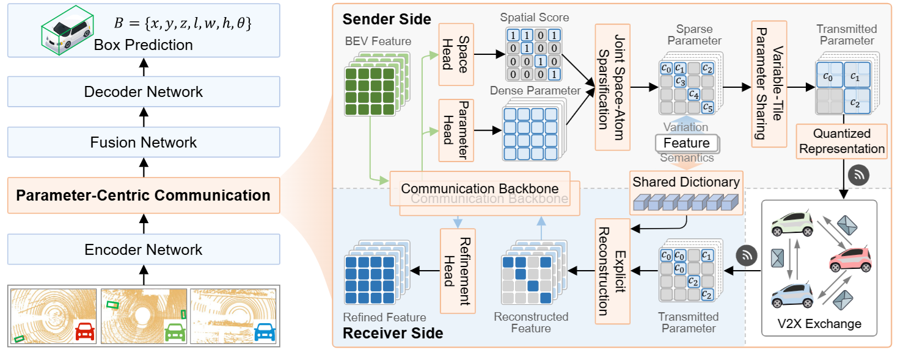

# ParaComm (TMC 2026)

Rethinking What to Communicate for Collaborative Perception: A Parameter-Centric Perspective

[Paper](https://doi.org/10.1109/TMC.2026.3741641) | [Project Page](https://weiquanmin.github.io/ParaComm/)

https://github.com/user-attachments/assets/67579e22-2a6f-4db6-aee4-1a25ab9d80c2

## Highlights

- **Parameter-centric communication:** ParaComm transmits compact parameters that specify how locally shared dictionary atoms are combined to reconstruct collaborative BEV features.
- **Compact transmission:** Spatial and atom sparsification, parameter sharing, and low-bit quantization jointly reduce communication volume.
- **Strong accuracy–communication trade-off:** On OPV2V, ParaComm achieves over **350× communication compression** while improving detection accuracy over standard full-feature collaboration.
- **Broad validation:** Experiments on **OPV2V, V2XSet, and DAIR-V2X**, with multiple base collaborative perception models, demonstrate its effectiveness and generality.



## Abstract
Collaborative perception enhances autonomous driving by allowing agents to share complementary perceptual information. Existing methods typically adopt a Feature-Centric Communication (FCC) perspective that focuses on selecting or compressing feature representations for transmission. A shared representational basis offers an opportunity to reduce online communication by encoding observations through compact parameters. Building on this idea, we introduce a Parameter-Centric Communication (PCC) perspective, in which these parameters specify the composition of representational bases retained locally at each agent. We instantiate PCC as ParaComm, a learnable dictionary-driven framework for communication-efficient collaborative perception. In ParaComm, continuous parameters learned from BEV features specify how shared dictionary atoms are combined to form the current collaborative representation. To reduce transmission volume, ParaComm progressively sparsifies these parameters across spatial locations and dictionary atoms and further compacts them through parameter sharing and low-bit quantization. The receiver then explicitly reconstructs collaborative features using the transmitted parameters and its local copy of the shared dictionary. Extensive experiments on OPV2V, V2XSet, and DAIR-V2X validate the effectiveness and generality of ParaComm. On OPV2V, for example, it reduces the communication volume from 34.375 MB to 99.688 KB, corresponding to over 350× compression, while still improving detection accuracy relative to standard full-feature collaboration.

## Installation

You can refer to the CoAlign Installation Guide [Chinese Ver.](https://udtkdfu8mk.feishu.cn/docx/LlMpdu3pNoCS94xxhjMcOWIynie) or [English Ver.](https://udtkdfu8mk.feishu.cn/docx/SZNVd0S7UoD6mVxUM6Wc8If6ncc) to learn how to install this repo. 


## Data Preparation

The data preparation is also the same as that of CoAlign and [OpenCOOD](https://opencood.readthedocs.io/en/latest/md_files/data_intro.html). For the DAIR-V2X dataset, please use the [supplemented annotations](https://siheng-chen.github.io/dataset/dair-v2x-c-complemented/).

## Training Procedure

To ensure stable training and fast convergence for communication-efficient collaborative perception models, we use pre-trained base collaborative perception weights (including AttFuse, CoAlign, and MKDCooper) instead of training from scratch with the communication-efficient components attached.

### Quick Training

Download the provided pre-trained base weights `all_models_base` and move them to the `opencood/logs` directory. Note that these weights do not include the communication-efficient modules and follow the default OpenCOOD or CoAlign training strategies and parameters.

Run the following command to train ParaComm when using CoAlign as the base model on OPV2V:
```bash
CUDA_VISIBLE_DEVICES=0 python opencood/tools/train_comm.py --hypes_yaml opencood/hypes_yaml/OPV2V/pointpillar_sparse_dict_paracom.yaml
```

Run the following command to train ParaComm when using MKD-Cooper as the base model on OPV2V:
```bash
CUDA_VISIBLE_DEVICES=0 python opencood/tools/train_comm.py --hypes_yaml opencood/hypes_yaml/OPV2V/pointpillar_mkdcooper_sparse_dict_paracom.yaml
```

> You may need to update pre-trained path and dataset paths in the `xxx.yaml` such as `pretrained_noncomm_dir`,  and `root_dir`, `validate_dir`, `test_dir` to match your local environment.

After training, run inference to evaluate ParaComm (CoAlign base on OPV2V):
```bash
python opencood/tools/inference.py --model_dir opencood/logs/opv2v_coalign_paracom_atomtop4_bit4_top_ratio01_x
```

> You may need to update `opencood/logs/opv2v_coalign_paracom_atomtop4_bit4_top_ratio01_x` to match your true log dir.


## Checkpoints

The main checkpoints can be downloaded [here](https://drive.google.com/drive/folders/1qNLYrojelCGAjQydTSVOsgpWFfkctHT2?usp=drive_link), and then save them in the `opencood/logs` directory. Note that our checkpoints rely on spconv-cu116==2.3.6.

We provide two types of checkpoints: pre-trained base models and the full communication-efficient ParaComm models.


## Citation
```
@article{wei2026paracomm,
  title = {Rethinking What to Communicate for Collaborative Perception: A Parameter-Centric Perspective},
  author = {Wei, Quanmin and Dai, Penglin and Li, Wei and Wu, Xiao and Chen, Chao and Yu, Zhaofei},
  journal = {IEEE Transactions on Mobile Computing},
  year = {2026}
}

```

## Acknowledgements

Thank for the excellent collaborative perception codebases [OpenCOOD](https://github.com/DerrickXuNu/OpenCOOD) and [CoAlign](https://github.com/yifanlu0227/CoAlign).
